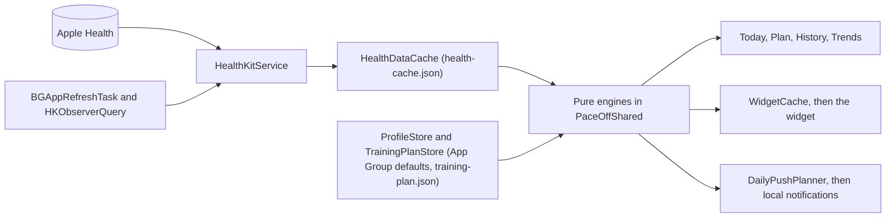
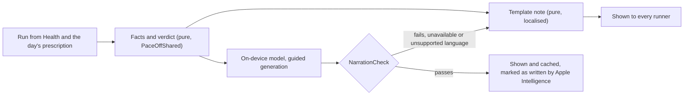

# Pace Off — Architecture

Where the app stands, where it is going, and the answers to the two questions the research of November 2026 was asked: does Pace Off need a backend, and what should it build on Apple Intelligence.

`CLAUDE.md` holds the rules for day-to-day work, `ROADMAP.md` the queue. This file holds the target and the reasons. The evidence is in `docs/research-2026-11.md` (in Hungarian).

## The short version

- **Pace Off stays on the device.** No roadmap item through Step 3 needs a server of ours.
- **The goal is the number-one coach for runners with an iPhone and an Apple Watch.** It owns the start of the day (what to run, and why) and the end (how it went, and what changes because of it). Recording the run stays with Apple's Workout app until the owner decides otherwise (ROADMAP D-10).
- **One deterministic core decides; a language model only phrases.** Every number and every verdict a runner sees comes from a pure, tested function.
- **Apple's services are used in a fixed order of preference:** the device first; then system services that give us no data (WeatherKit, WorkoutKit, App Intents, the on-device model); then the runner's own iCloud, for non-health state only and by the owner's decision; a server of ours only past the four boundaries named below.
- **The first Apple Intelligence feature is the coach's note:** a review of each run and the reason for today's prescription, phrased by the on-device model where it exists, from a template everywhere else (ROADMAP F-19).

## What must stay true

1. **Apple Health is the source of truth for everything measured.** Pace Off stores decisions and facts derived from Health, never a second copy of the samples. `health-cache.json` is a cache for a fast cold launch and can be deleted at any time.
2. **Decisions are pure functions in `PaceOffShared`:** `Sendable`, no I/O, unit-tested. Views, services, the widget, intents and notifications show what those functions return and decide nothing themselves.
3. **One prescription a day.** Today, the widget, the pushes, the watch and Siri name the same workout, from one function (ROADMAP R-10).
4. **The runner's data never reaches a machine we run.** The privacy label stays *Data Not Collected*. Anything that would change it is the owner's decision.
5. **Nothing the app does alone needs an account.**
6. **A language model never decides load, never supplies a number and never runs in the background.**
7. **A rule that changes a runner's load shows its inputs.** The readiness screen already does; the single-run cap, the pace source and every plan change follow.

## Today



Four targets share one source folder, `PaceOffShared/`, and one App Group. `@MainActor @Observable` singletons own state and side effects; the engines are listed in `CLAUDE.md`. There is no network code, no package and no account system.

What the structure lacks today, and what fills each gap:

| Gap | Where it shows | Filled by |
|---|---|---|
| Two prescriptions | `PushTargetEngine`'s target and the plan's workout are computed and shown side by side; a push can name two distances | `DayPrescription` (R-10) |
| No memory | Nothing records what was prescribed or how a run went. `HealthKitService.toRunRecord` gives a run a new `id` on every Health read, so nothing can be attached to it | `RunLedger`, keyed by the Health workout's UUID (F-18) |
| A frozen plan | `TrainingPlanReconciler` re-paces the remaining weeks; their distances never change | "Rebuild from here" in the generator (F-21) |
| A trusted model | `AppleIntelligenceCopy.sanitize` checks length only | `NarrationCheck` (R-12) |
| Copy in many places | `VoiceCopy`, `DailyPushPlanner` and the views each build English, kilometre-only text | One formatter (F-01), a String Catalog (F-08), `CoachTemplates` (F-19) |
| A watch app that can't see the phone | The App Group doesn't sync between phone and watch (D-01) | WorkoutKit into Apple's Workout app (F-12) |

## Target: four rings

Each ring is further from the runner's phone than the one before. Work starts in the innermost ring that can do the job.

| Ring | What lives there | Examples | Rule |
|---|---|---|---|
| **0 · The device** | Health, App Group files, the engines, the on-device model | Everything shipped today; the prescription, the cap, the coach's note, shoes, share cards | The default. No flag needed |
| **1 · Apple system services** | Requests that go to Apple and return nothing to us | WeatherKit, WorkoutKit, App Intents, MapKit, StoreKit 2, App Store Connect analytics | Allowed. The PR names any new entitlement or privacy string |
| **2 · The runner's own iCloud** | Non-health state, synced or shared through Apple | iCloud key-value store or a private CloudKit database for plan, goal and settings; `CKShare` for a private circle; Game Center | The owner's decision each time (D-08, D-09). Never Health samples or values derived from them |
| **3 · A server of ours** | Anything we would operate | Public feed, clubs, live-tracking links, Garmin's API, a cloud LLM, Android, web | Not planned. Reopened only at the four boundaries below |

## Does Pace Off need a backend?

No. Staying on the device gives three things a server can't give back:

- **The privacy label stays true.** By Apple's definition, data processed only on the device is not collected.
- **There is no cost per runner,** so the app can stay free, or be sold once.
- **There are no controller duties.** Health data is a special category under GDPR Article 9: explicit consent, an impact assessment at scale, breach notification within 72 hours, processor contracts. Washington's My Health My Data Act adds a private right of action that analysts read as covering fitness apps.

Money is not the obstacle. The research's estimate for a light backend (about 100 requests per runner per month, no media) is about US$5 a month on Cloudflare Workers with D1 up to 100 thousand monthly runners, and under US$100 at a million. The burden is the operation: an account system with deletion, moderation of anything social, backups, incident handling, and a new privacy policy and label, for one developer, from the first stored record.

### What Apple's serverless services cover

| Need | Route without a server of ours | Limit or risk |
|---|---|---|
| Keep plan, goal and settings across devices | iCloud key-value store (1 MB), or a private CloudKit database with `CKSyncEngine` | Needs an iCloud account. Nothing derived from HealthKit may go in |
| A running buddy, a small group | `CKShare`, up to 100 participants per share | Everyone needs iCloud. No Android |
| Challenges and leaderboards among friends | Game Center leaderboards and challenges (OS 26 and later) | Looks like a game. No evidence yet that App Review accepts it in a fitness app |
| Weather | WeatherKit, 500,000 calls a month with the membership | Apple Weather attribution, a new entitlement and a location string |
| The plan's workout during the run | WorkoutKit schedules it into Apple's Workout app | One alert per step. The scheduling limit is undocumented |
| Live state on the Lock Screen | A Live Activity updated by the app, without push | Needs our own workout session (D-10) |
| Payment | StoreKit 2, verified on the device | Less control than with server-side receipts |
| AI | The on-device model; Private Cloud Compute from iOS 27 | Device and language limits; a daily quota |
| Usage figures | App Store Connect analytics | Only runners who opted in to sharing |
| Public feed, clubs, live tracking by link, Garmin's API, a cloud LLM, Android | None | A server of ours |

### The iCloud rule

App Review Guideline 5.1.3(ii) says apps "may not store personal health information in iCloud", and the developer licence bars iCloud and CloudKit for sensitive, individually identifiable health information. Apple has not said publicly where that line runs, and developers' questions about it from 2020 to 2026 went unanswered.

So the design rule is strict:

- Health samples and everything derived from them (readiness, HRV baselines, run metrics, the ledger's verdicts) stay on the device. The system's own Health sync carries the raw data between the runner's devices.
- iCloud may hold plan structure, the goal, settings and shoe names, and only once the owner has said yes (D-08).
- Before a sharing feature ships (D-09), book an App Review consultation.

The label under Ring 2: read literally, Apple's definition keeps *Data Not Collected* for the private database and `CKShare`, because we can't reach the data and Apple is not a third-party partner. Apple has never confirmed that in writing. Anything written to CloudKit's public database is collected data and ends the label.

### Four boundaries that need a server

1. **Public social features:** a feed, clubs, live tracking by link, a push triggered by another runner. CloudKit's public database has no server logic, so no ranking, moderation or anti-cheat, and its request quota is unpublished.
2. **Full-fidelity data from Garmin, COROS or Polar watches.** Garmin Connect writes workouts to Apple Health without the GPS track and with sparse heart rate; COROS and Suunto keep HRV in their own apps. For these runners Pace Off has weekly distance, plan completion and coarse heart rate, and no map, splits or readiness. Garmin's developer programme takes organisations only and pushes data to an HTTPS endpoint. A user-started FIT or GPX import from the share sheet would avoid the server; nobody has tried it yet (D-14).
3. **A third-party cloud LLM.** The key has to sit behind a server, Guideline 5.1.2(i) requires explicit permission before personal data goes to third-party AI, and the label changes.
4. **Android and the web.**

None is in the roadmap. Reopen the question when demand from Garmin and COROS runners can be shown, or when a private circle outgrows `CKShare`'s 100 participants.

If a boundary is ever crossed, build the smallest thing that works: stateless functions at the edge, no health data at rest, an EU region, Sign in with Apple as the only identity. The engines on the device stay the source of every training decision; a server relays and never computes training.

### Strava

No integration. Under its API policy of June 2026 a self-service app stops at ten connected athletes, the developer must hold a subscription, a runner's data may be shown only to that runner, and any AI use of the data is banned. Pace Off records nothing, so runs reach Strava from the app that recorded them. The same policy is an opening: runs read from Apple Health carry no such terms, so on-device AI can work on them freely.

## Apple Intelligence: the coach's note

### What Apple offers a running app (November 2026)

| Entry point | What it gives | Limits | Role here |
|---|---|---|---|
| Foundation Models, on-device model | Free, offline summarising, rephrasing and guided generation into Swift types | 4,096 tokens on iOS 26, up to about 8,000 on newer phones with iOS 27. iPhone 15 Pro and later. No on-device model on Apple Watch. German is supported; Hungarian, as far as the evidence shows, is not | The coach's note (F-19); later, plan changes in a sentence (D-12) |
| Private Cloud Compute | A 32,000-token window with reasoning levels, no API key or token cost | iOS 27, an entitlement, a daily quota per runner, and the text leaves the phone | An optional weekly or block review (D-13) |
| App Intents | Shortcuts, Spotlight, widgets, Control Center; Siri's AI later | No fitness schema. Custom actions for Siri's AI reach the App Store in spring 2027, and that Siri is not available in the EU | Build now (F-16) |
| Workout Buddy | Apple's own spoken companion | No developer API | Can't build on it |
| A third-party cloud model | A stronger model behind the same session API | A key and a server, explicit permission, a new label | Not recommended |

Apple's own guidance is that the on-device model is good at summarising, extracting, rephrasing and classifying, and poor at arithmetic and reasoning. The market shows the same from the other side: reviewers call Garmin's and Strava's AI summaries thin because they don't know what a run was for, studies rate LLM-written training plans poorly, and Runna says its plans are written by coaches and adjusted by an algorithm, not by AI.

Pace Off wrote the prescription, so it knows what the run was for. That is the feature.

### The first feature: how the run went, and why today's is what it is



A sketch of the pure half (names may change in the PRs):

```swift
// PaceOffShared: pure, Sendable, unit-tested
public enum RunVerdict: String, Sendable {
    case onPlan, tooFast, tooSlow, cutShort, wentLong, easyTooHard, unplanned
}

public struct RunReviewFacts: Sendable, Equatable {
    public let prescribedMeters: Double?        // from the day's prescription
    public let paceBand: ClosedRange<Double>?   // seconds per km
    public let distanceMeters: Double
    public let averagePace: Double
    public let fadePercent: Double?             // PaceDecayAnalyser
    public let shareAboveZone2: Double?         // F-15
    public let verdict: RunVerdict              // decided here, never by the model
}

public struct CoachNote: Sendable, Equatable {
    public enum Source: Sendable { case template, appleIntelligence }
    public let headline: String
    public let body: String
    public let tip: String?
    public let source: Source
}

public enum CoachTemplates {
    public static func note(for facts: RunReviewFacts, voice: Voice) -> CoachNote
}

public enum NarrationCheck {
    /// True when `candidate` carries exactly the numbers of `original`.
    public static func accepts(_ candidate: String, for original: String, maxLength: Int) -> Bool
}
```

The model's half, `CoachNarrator`, lives in the app target behind `#if canImport(FoundationModels)`, as `AppleIntelligenceCopy` does today.

The same facts serve the morning: which signal (readiness, yesterday's run, the plan's week, the single-run cap, the forecast) moved today's prescription, and by how much.

### Rules for every model feature

1. **The engine decides, the model phrases.** The verdict and every number come from the facts.
2. **Every runner gets the template.** The model's text replaces it only where the model exists and its text passes the check. On phones before iPhone 15 Pro, and in Hungarian, the template is the product, so the templates get the writing effort.
3. **Check before showing.** The output must carry exactly the numbers of the facts, stay within a length cap and use no diagnosis or treatment wording. Otherwise the template stays. The same check guards today's voice-line rewrite (R-12).
4. **Foreground only.** Prewarm when Today or a run opens. Never call the model from the background refresh or a HealthKit delivery: the system rate-limits it there. Pushes carry template text.
5. **Ask the system, don't keep a list.** `SystemLanguageModel.default.availability` and `supportsLocale(_:)` decide. If Apple adds Hungarian, the feature appears without a release.
6. **Small prompts.** Facts go in as short key and value lines. The whole exchange stays under about 1,000 tokens.
7. **One prompt per model generation.** Several generations are in use at once and none can be pinned. Keep a fixture set of facts with acceptable outputs, and run it on a device before a prompt changes (Apple's Evaluations framework on iOS 27).
8. **Say so, and let the runner object.** A note from the model is marked, Profile has a switch, and "Report this note" puts the template back.

Nothing leaves the phone, so the privacy label and the Health usage text don't change.

Apple's acceptable-use rules for the framework prohibit inaccurate or dangerous output in medical domains and unsupervised decisions in high-risk ones. Rules 1 and 3 are how Pace Off stays inside them.

### After the first feature

- **A plan change in a sentence** (D-12). "I'm away Thursday to Sunday" becomes a typed command (skip, move, pause, with dates) through guided generation; the plan's own rules check it; the runner sees a preview and confirms. One field and one answer, not a conversation. It needs the adaptive plan (F-21) and the owner's yes, because chat surfaces are out of scope.
- **A longer review on Private Cloud Compute** (D-13). Optional, with a clear line that the request leaves the phone. First find out whether text derived from HealthKit may be sent under the licence's health clause.
- **App Intents** (F-16) need no model. The entities and actions built now are what Siri's AI will use later.

## New building blocks

| Block | Kind | Item | Used by |
|---|---|---|---|
| `NarrationCheck` | Pure | R-12 | `AppleIntelligenceCopy`, `CoachNarrator` |
| `DayPrescription` | Pure | R-10 | Today, `WidgetCache`, `DailyPushPlanner`, intents, the WorkoutKit schedule |
| Single-run cap | Pure | R-11 | `PushTargetEngine`, `DayPrescription`, the plan rebuild |
| Workout blocks | Pure | F-12a | The WorkoutKit scheduler (F-12b), run review, treadmill view |
| Distance and pace formatter | Pure | F-01 | Every screen, push and widget |
| String Catalog | Resource | F-08 | All copy |
| Best efforts | Pure, with a small store | F-14 | PBs, the pace source (F-17), the prediction |
| Heart-rate zones | Pure | F-15 | Run detail, run review, load |
| `RunLedger` | Actor, JSON file | F-18 | Run review, plan adherence, shoes, the recap, the plan rebuild |
| `CoachTemplates`, `CoachNarrator` | Pure; service | F-19 | Run detail, Today, pushes |
| Rebuild from here | Pure, in the generator | F-21 | Skip, move, pause, a tune-up race, settings changes |

## Data and persistence

Files in the App Group container today: `training-plan.json`, `health-cache.json`, `profile-photo.jpg`. Planned: `run-ledger.json` (F-18), `shoes.json` (F-30), a forecast cache (F-10b).

- **A run's identity is its Health workout UUID.** `RunRecord` carries it, and everything the app knows about a run hangs on it.
- **The ledger holds one row per day and per run:** the day's prescription as it was shown, the verdict, best efforts, seconds per zone, the shoe, the runner's own word (F-20), and the coach's note with its source.
- **Files are versioned and forgiving.** New fields are optional, so an older file still decodes, as plans without strength sessions do today.
- **Derived data can be rebuilt.** Deleting the ledger loses only what the runner typed (shoe choices, how they felt) and the prescriptions of past days.
- **"Delete my data" covers every new file:** each one joins `AppGroup.containerFiles`.
- **JSON is enough.** Ten years at 250 runs a year is 2,500 rows, well under 2 MB. Revisit only if queries beyond "by day" and "by run" appear; SwiftData would be the owner's decision.

## The run itself

- **Now:** Apple's Workout app records. F-12 sends the plan's next seven days there through WorkoutKit: a custom workout with a warm-up, repeated work and recovery blocks, a cool-down, and one pace alert per step. The scheduling limit is undocumented, so the scheduler reads `maxAllowedScheduledWorkoutCount` at run time, and the watch shows seven days either side of today.
- **Our own watch app** can't see the phone's App Group. Once F-12 is proven on a real watch, the recommendation for D-01 is to hide it.
- **Recording in Pace Off** (D-10) would reverse the PRD, which leaves the run to Apple. The case for it: 72% of Strava's users recorded with a phone in 2025, since iOS 26 a workout session runs on iPhone with a Live Activity, and plan-aware audio ("this rep is 6 seconds faster than threshold") needs a session of our own, because Workout Buddy can't be driven. The case against: GPS, battery, pause and crash recovery are a large surface, and F-12 already serves Apple Watch owners. Decide after F-12 has been used for a few weeks.

## Open questions

Three can be settled on a real iPhone and Apple Watch in minutes; they are in ROADMAP "Owner's part":

- How many workouts does `WorkoutScheduler` accept on iOS 26 and 27?
- Does Workout Buddy speak during a workout that WorkoutKit scheduled?
- Does the on-device model list Hungarian among its languages?

Two need Apple:

- The daily quota of Private Cloud Compute, and whether it is available in the EU.
- Whether App Review accepts CloudKit sync of workout-derived data, and Game Center in a fitness app.

A caution on the evidence: during the research the session could open pages only on developer.apple.com and GitHub. Facts about competitors come from search-result summaries, and several details of iOS 27 were read the same way. Check an API against the SDK that CI builds with before an item relies on it, and keep iOS 27-only calls behind `#available`.
